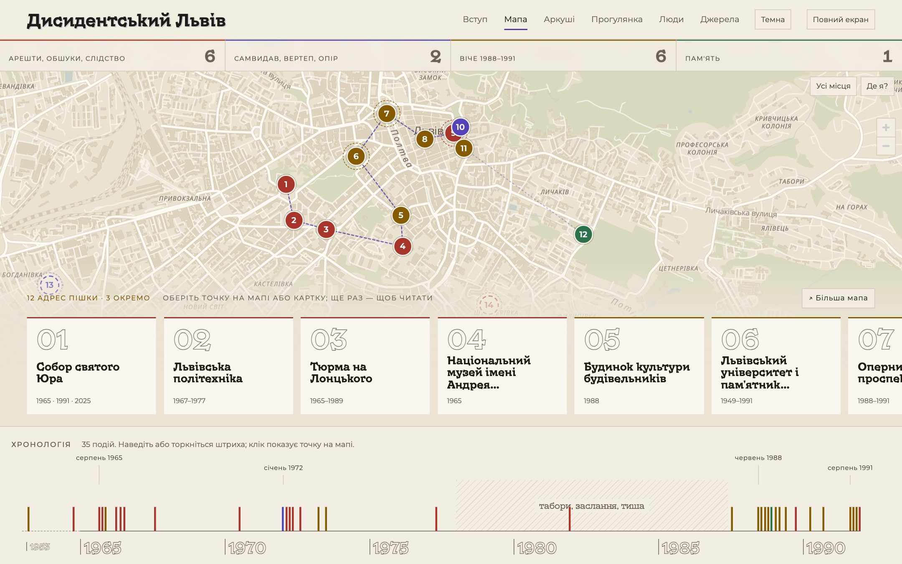
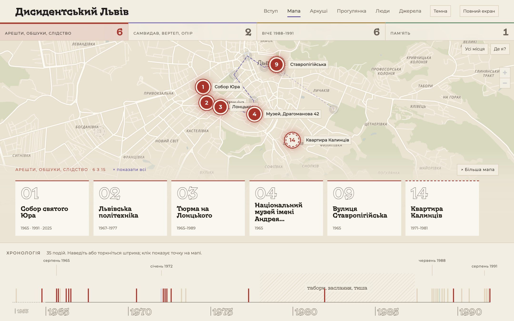
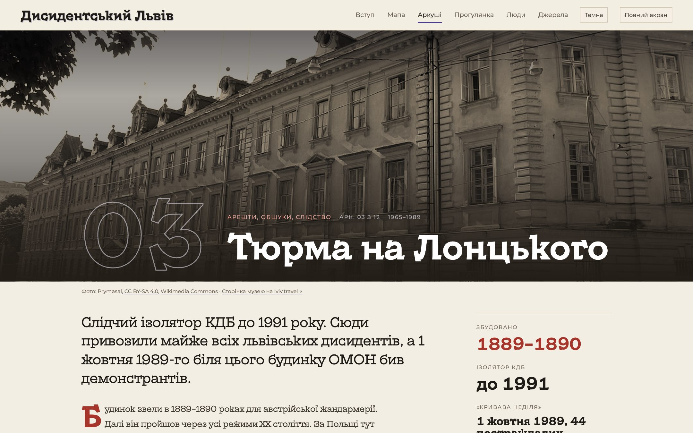
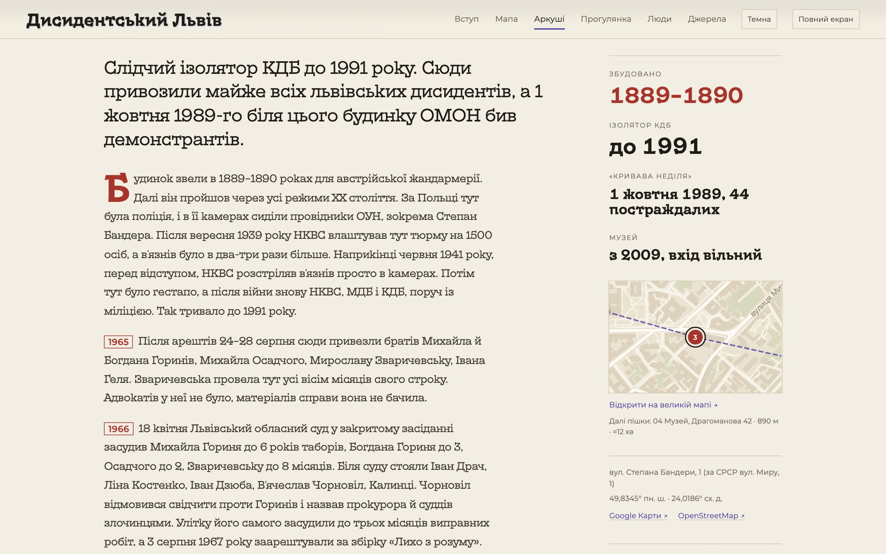
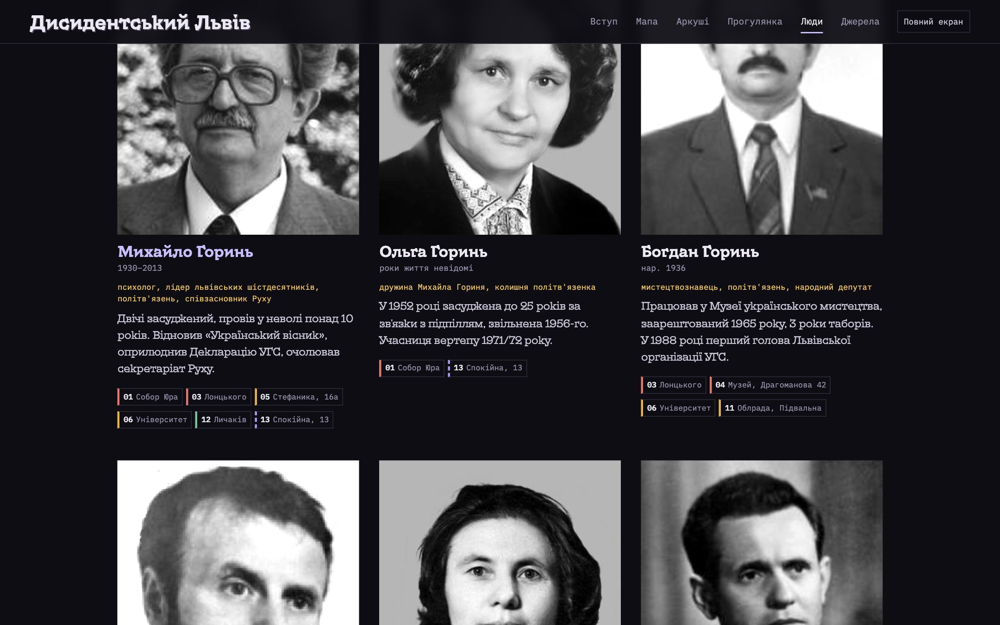
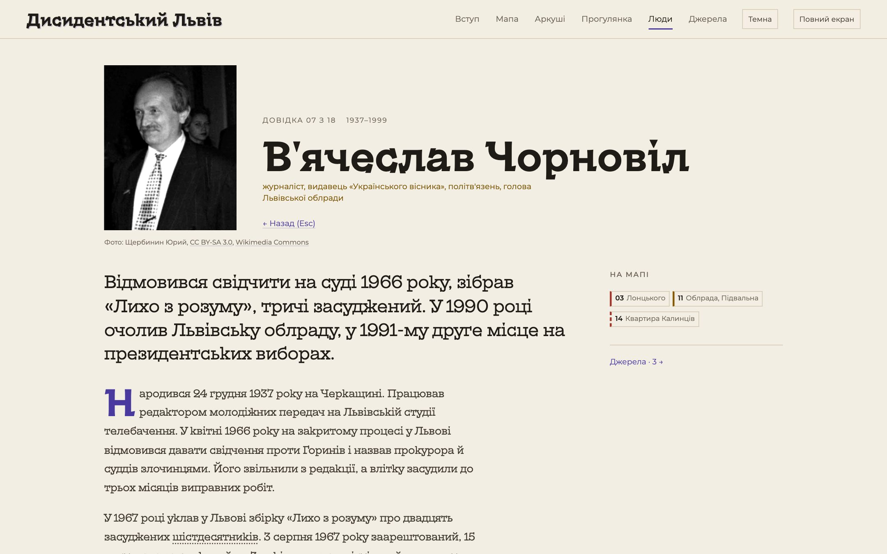
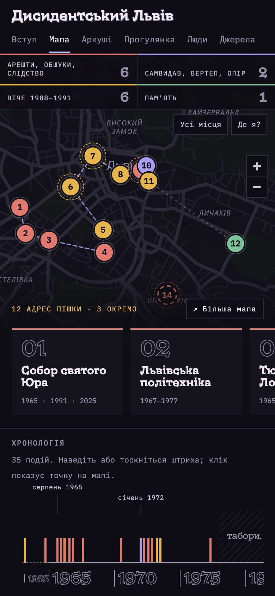
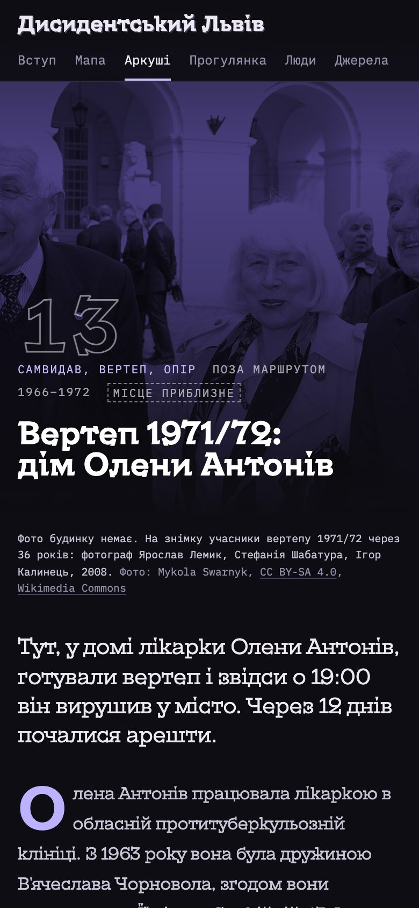

# Дисидентський Львів, 1965–1991

**Сайт:** https://taraskonoval.github.io/dissident-lviv/

Інтерактивна мапа, піший маршрут і архів історій про львівських шістдесятників і дисидентів. П'ятнадцять адрес у місті, де людей заарештовували, обшукували й судили, де колядували з вертепом, передруковували самвидав і де в 1988–1991 роках збиралися віча.

Творчий проєкт для курсу «Дисиденти: історія, етика, критичне мислення» (УКУ).



## Що всередині

- **15 місць.** 12 адрес пішого маршруту в центрі (від собору Юра до Личаківського цвинтаря, близько 6,4 км) і 3 окремі місця: дім вертепу на Спокійній, квартира Калинців, стадіон «Дружба».
- **18 біографій** з портретами: Горині, Чорновіл, Калинці, Стус, Шабатура, Маринович, Гель, Зваричевська, Антонів та інші.
- **35 подій** на хронології 1953–1991: від перших арештів 1965 року до серпня 1991-го.
- **Словник** термінів епохи: самвидав, «профілактика», стаття 62, операція «Блок», УГГ і УГС.
- **Понад 50 джерел** з 20 видань і архівів, зібраних на одній сторінці.
- На кожному аркуші є блок **«На полях»**: де джерела розходяться в датах, числах чи місцях. Непевність тут показано чесно, це частина задуму.

## Дві зали

Сайт побудований як музейна експозиція з двох зал.

**Зала мапи.** Уся мапа на екрані: стрічка аркушів унизу, фільтр за темами вгорі, хронологія-штрихкод під мапою. Тема «Арешти», «Самвидав», «Віче» чи «Пам'ять» підсвічує свої точки, картки й події. Кнопка «Більша мапа» ховає хронологію.



**Зала читання.** Кожне місце — окремий аркуш: світлина на всю ширину, історія, ключові факти великими цифрами, люди з портретами, міні-мапа й відстань до наступної точки пішки.





**Люди.** Покажчик імен і окремі сторінки з біографіями.





## Прогулянка і презентація

- **Режим прогулянки:** маршрут з відстанями й часом, «Я тут → Прийшли» для руху від точки до точки, весь маршрут у Google Картах одним посиланням.
- **Презентація:** клавіші ← / → гортають аркуші, F — повний екран, Esc закриває сторінку людини.
- **Прямі посилання:** `#map`, `#stop-3`, `#vertep`, `#person-iryna-kalynets`, `#walk`, `#people`, `#sources`, `#glossary`.

## На телефоні

<p>
  
  &nbsp;
  
</p>

## Фото, мапа, шрифти

- Світлини місць і більшість портретів — з Wikimedia Commons під вільними ліцензіями; автор і ліцензія підписані під кожним фото й зібрані на сторінці «Джерела». Архівні фото Центру міської історії захищені авторським правом, тому на них лише посилання.
- Мапа: © учасники OpenStreetMap, OpenMapTiles, OpenFreeMap.
- Шрифти: KyivType (Дмитро Растворцев), Montserrat (SIL Open Font License).
- Дві теми: темна «Експозиція» і світла «Архівний папір»; перемикач у шапці, за замовчуванням — як налаштовано на пристрої.

## Запуск

```bash
npm install
npm run dev
```

Сайт публікується на GitHub Pages автоматично з гілки `main`.
